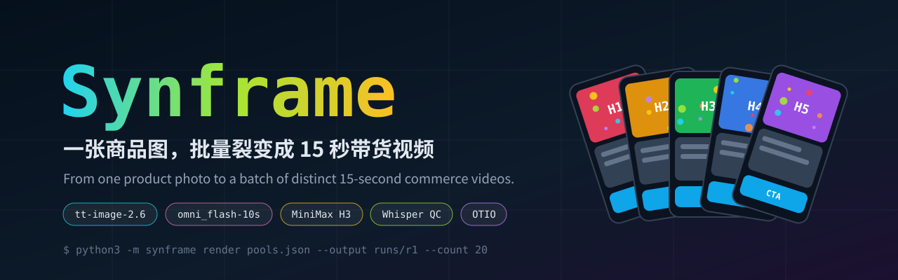
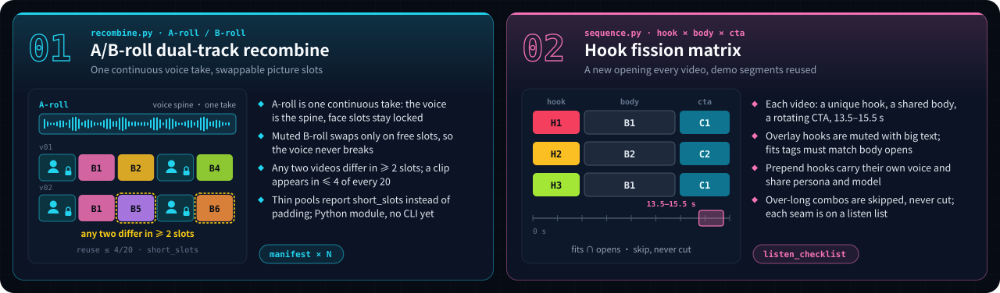
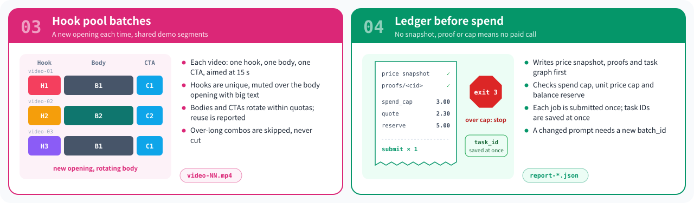
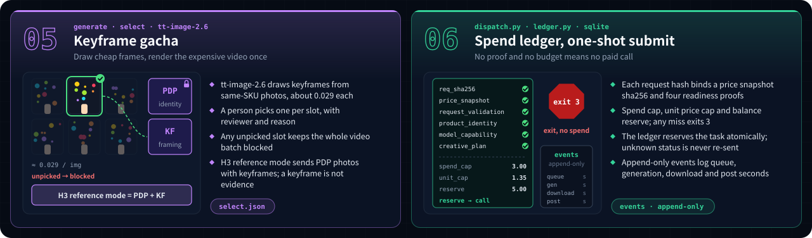
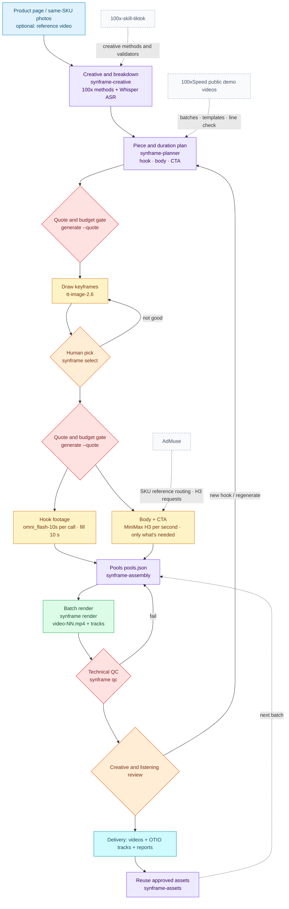

[简体中文](README.md) · **English**

<p align="center"></p>

<p align="center">
  <a href="LICENSE"></a>
  
  
  
  
</p>

> Turn one product photo into a batch of 15-second commerce videos, each with its own opening, a faithful product and an auditable spend.

Synframe is a set of Agent Skills plus a local CLI. It draws keyframes on a cheap image model first and spends on video only after a person picks them. Video material is split into hook, body and CTA pools, combined into N finished videos within reuse quotas, then checked technically. No paid call goes out without a price snapshot, proof files and a spend cap. Creative and listening acceptance always stays with a person.

## Highlights

<p align="center"></p>
<p align="center"></p>
<p align="center"></p>

## Workflow



Dashed boxes are design references, not runtime dependencies.

| Stage | Owner | Output | Pass condition |
|---|---|---|---|
| Creative and breakdown | `synframe-creative` | Claims, hook directions, original-language transcript | Claims verifiable on the product page; target language kept verbatim |
| Duration plan | `synframe-planner` | Clip plan | No clip exceeds the chosen model's single-call maximum; unknown maximum means no submit |
| Keyframes | `generate` + tt-image-2.6 | `out/images/`, report | Budget gate passed, images downloaded |
| Pick | person + `select` | Selection records | Every slot has a reviewer and reason |
| Video | `generate` + omni_flash-10s / H3 | `out/videos/`, `report-*.json` | Each job submitted once, task ID saved |
| Render | `render` | `video-NN.mp4`, `-tracks.json` | 13.5 to 15.5 s, no repeated hook |
| Technical QC | `qc` | `qc/technical.json`, `qc/contact.jpg` | Critical terms present, ASR changes ≤ 2, -14±1 LUFS, peak ≤ -1 dBFS, no black frames |
| Acceptance | person | Review notes | Product identity, causal action, speech and captions checked one by one |

## Install

```bash
git clone https://github.com/peipeijiang/synframe.git
cd synframe
python3 install.py --check    # show what would happen
python3 install.py            # install into ~/.agents/skills, then run the doctor
```

The installer only manages the `synframe*` skill directories it installed and never overwrites anything else:

- **Existing directory it did not install**: skipped with a notice.
- **`--upgrade`**: replaces only unchanged managed copies; old versions move to `skills-backups/synframe-<timestamp>`.
- **`--uninstall`**: removes only unchanged managed copies.
- **`--doctor`**: dependency check only. It also runs after every install or upgrade and says how to install what is missing.

### Dependencies and companions

| Dependency | Role | Source |
|---|---|---|
| Python ≥ 3.10, ffmpeg / ffprobe | Render and QC; needs the drawtext, loudnorm, ebur128 and blackdetect filters | Required, `brew install ffmpeg` |
| Caption font | Big text and captions; override with `SYNFRAME_FONT` | Required, any system font |
| openai-whisper | Original-language ASR for `qc`; reads cached weights only | Optional, `pip install openai-whisper` |
| opentimelineio | OTIO export | Optional, `pip install -r requirements-optional.txt` |
| Node.js + AJV | Runs the upstream validators in vendor/100x | Optional |
| `LK888_API_KEY` | Paid generation (tt-image-2.6, omni_flash-10s, MiniMax H3) | Required for paid runs; the doctor checks presence only |
| [ad-muse](https://github.com/peipeijiang/ad-muse) | Single-shot product fidelity and reference routing | Companion skill; some scripts vendored in vendor/admuse |
| [100x-skill-tiktok](https://github.com/kezd088/100x-skill-tiktok) | Script segmentation, localization, persona, visual fission | Companion skill; vendored in vendor/100x |
| [egm](https://github.com/google/elephant-goldfish-model) | Fresh-eyes design review before a large batch | Optional plugin |

## Quick start

Run local render and QC on synthetic media first. No spend, no network:

```bash
cd examples/quickstart
export PYTHONPATH="$PWD/../.."                          # lets python3 -m synframe find the code
python3 make_media.py                                   # 3 hook clips, 1 voice take, a product image
python3 -m synframe render pools.json --output runs/r1 --count 3
python3 -m synframe qc runs/r1 --no-transcribe          # partial when ASR is skipped
```

Output lands in `runs/r1/`: three 15-second videos, track files and `qc/contact.jpg`. The paid path runs from the same directory in this order, and you can stop after any step:

```bash
python3 -m synframe generate image-spec.json            # offline check, sends nothing
python3 -m synframe generate image-spec.json --quote    # live prices, no spend
python3 -m synframe generate image-spec.json --submit   # submit within spend_cap and download
python3 -m synframe select select.json                  # record the picked keyframes
python3 -m synframe generate video-spec.json --submit   # keyframes + product photos to video
```

`generate` exits with code 3 when keyframes are unpicked, the cap is exceeded or the balance is short; nothing is charged in that case. Rerunning the same spec only polls and finishes downloads; it never resubmits.

## Cost model

| Model | Billing | Use | Reference price (2026-11-10 snapshot) |
|---|---|---|---|
| tt-image-2.6 | per image | Keyframes; draw several, then pick | about 0.029 / image |
| omni_flash-10s | per call | Fill 10 s with 3 scenes, cut into hooks | about 0.9547 / call |
| MiniMax H3 | per second | Body and CTA, only the integer seconds needed | about 0.1123 to 0.1647 / s, by channel |

One measured run: 12 keyframes + 3 videos cost 3.61 (LK888 credits) and produced 11 finished 15-second videos, about 0.33 each. Prices change; trust the live `--quote` snapshot.

## Limits

- LK888 is the only paid adapter so far; other providers need their own `providers/` module and tests.
- A technical QC pass is not a release. Product details, causal action, speech and captions need human review.
- Two separately generated voice takes may not sound alike; listen before cross-combining them.
- Generator watermarks are not removed, and nothing is published automatically.
- OTIO export has not been import-tested in a specific editor.

## License

MIT. The vendored `vendor/100x` (kezd088/100x-skill-tiktok) and `vendor/admuse` are MIT as well; sources and commit are in [NOTICE.md](NOTICE.md).
