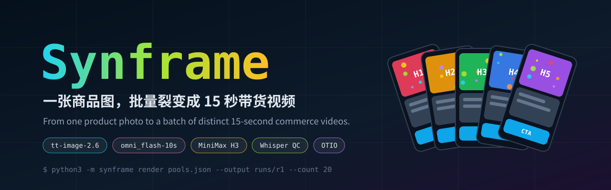
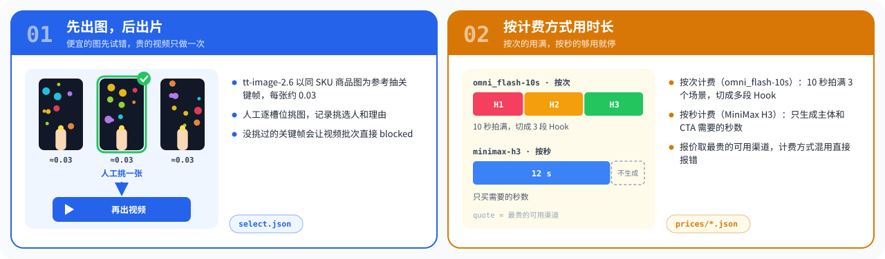
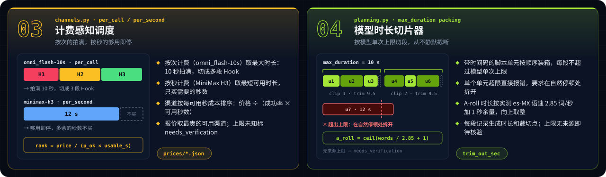
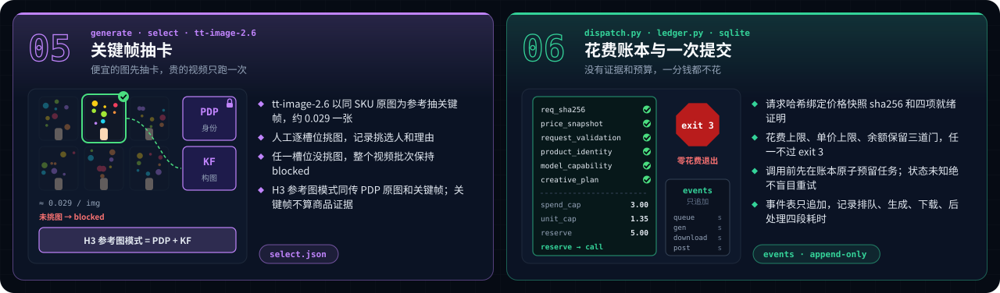
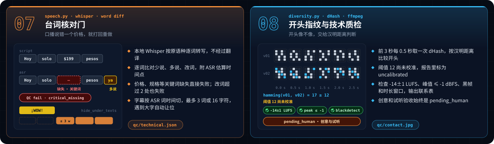
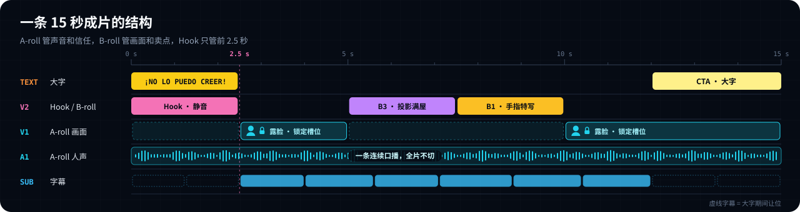
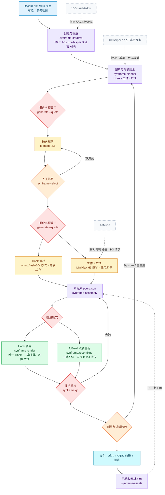

**简体中文** · [English](README.en.md)

<p align="center"></p>

<p align="center">
  <a href="LICENSE"></a>
  
  
  
  
</p>

> 把一张商品图，变成一批开头各不相同、商品不走样、花费可对账的 15 秒带货视频。

Synframe 是一组 Agent Skill 加一个本地命令行。它先用便宜的图片模型抽关键帧，人工挑图后才花钱生成视频；时长按各模型的单次上限和计费方式切段。批量有两种模式：Hook 裂变（唯一 Hook + 共享主体 + 轮换 CTA）和 A/B-roll 双轨重组（一条连续口播做主轴，只替换 B-roll 槽位）。成片过台词核对、开头指纹和响度质检。付费调用前必须有价格快照、证据文件和花费上限，创意与试听验收始终留给人。

## 核心亮点

<p align="center"></p>
<p align="center"></p>
<p align="center"></p>
<p align="center"></p>

### 15 秒成片结构

<p align="center"></p>

**A-roll**：真人口播，一条连续人声贯穿全片，露脸槽位负责信任感。
**B-roll**：静音的产品与场景画面，盖在口播上展示卖点，可以按槽位替换。
**Hook**：前 2.5 秒的静音画面加大字，每条成片都不一样。

A/B-roll 重组目前是 Python 模块 `synframe.recombine`，还没有命令行入口。

## 工作流程



虚线框是设计参考来源，不是运行时依赖。

| 阶段 | 负责 | 产物 | 通过条件 |
|---|---|---|---|
| 创意与拆解 | `synframe-creative` | 卖点、Hook 方向、原语言转写 | 卖点能在商品页核实，目标语言原样保留 |
| 时长规划 | `synframe-planner` | 片段计划 | 每段不超过所选模型的单次最大时长；上限未知则不提交 |
| 抽关键帧 | `generate` + tt-image-2.6 | `out/images/`、报告 | 预算门通过，图片已下载 |
| 挑图 | 人 + `select` | 挑选记录 | 每个槽位都有挑选人和理由 |
| 视频生成 | `generate` + omni_flash-10s / H3 | `out/videos/`、`report-*.json` | 每个任务只提交一次，任务号已落盘 |
| 成片 | `render` | `video-NN.mp4`、`-tracks.json` | 13.5 到 15.5 秒，Hook 不重复 |
| 技术质检 | `qc` | `qc/technical.json`、`qc/contact.jpg` | 关键词完整、ASR 差异 ≤ 2、-14±1 LUFS、峰值 ≤ -1 dBFS、无黑帧 |
| 验收 | 人 | 审片记录 | 商品身份、动作因果、口播与字幕逐条确认 |

## 安装

```bash
git clone https://github.com/peipeijiang/synframe.git
cd synframe
python3 install.py --check    # 只看会做什么
python3 install.py            # 安装到 ~/.agents/skills，然后自动体检
```

安装器只管理自己装过的 `synframe*` 技能目录，不覆盖已有内容：

- **已有同名目录且不是 Synframe 装的**：跳过并提示。
- **`--upgrade`**：只替换未被改动过的托管副本，旧版本移到 `skills-backups/synframe-<时间>`。
- **`--uninstall`**：只删除未改动的托管副本。
- **`--doctor`**：只做依赖检查。每次安装或升级后也会自动运行，缺什么就提示怎么装。

### 依赖与配套

| 依赖 | 作用 | 来源 |
|---|---|---|
| Python ≥ 3.10、ffmpeg / ffprobe | 渲染与质检，需要 drawtext、loudnorm、ebur128、blackdetect 滤镜 | 必需，`brew install ffmpeg` |
| 字幕字体 | 大字与字幕；可用 `SYNFRAME_FONT` 指定 | 必需，系统字体即可 |
| openai-whisper | `qc` 的原语言 ASR，只读本地已缓存的权重 | 可选，`pip install openai-whisper` |
| opentimelineio | 导出 OTIO 工程 | 可选，`pip install -r requirements-optional.txt` |
| Node.js ≥ 18 + AJV | 运行 vendor/100x 的上游校验器 | 可选，在 `vendor/100x/skills/<skill>` 里执行 `npm ci --ignore-scripts` |
| `LK888_API_KEY` | 付费生成（tt-image-2.6、omni_flash-10s、MiniMax H3） | 付费生成时必需，体检只检查是否设置 |
| [ad-muse](https://github.com/peipeijiang/ad-muse) | 单条镜头的商品保真与参考图路由 | 配套技能，部分脚本已收录在 vendor/admuse |
| [100x-skill-tiktok](https://github.com/kezd088/100x-skill-tiktok) | 脚本分段、本地化、人设、视觉裂变等创意方法 | 配套技能，已收录在 vendor/100x |
| [egm](https://github.com/google/elephant-goldfish-model) | 大批量前的零上下文设计评审 | 可选插件 |

## 快速开始

先用合成素材跑通本地成片和质检，不花钱、不联网：

```bash
cd examples/quickstart
export PYTHONPATH="$PWD/../.."                          # 让 python3 -m synframe 找到项目代码
python3 make_media.py                                   # 生成 3 段 Hook、1 段口播和商品图
python3 -m synframe render pools.json --output runs/r1 --count 3
python3 -m synframe qc runs/r1 --no-transcribe          # 不跑 ASR 时状态为 partial
```

产物写在 `runs/r1/`：3 条 15 秒成片、轨道文件和 `qc/contact.jpg`。付费流程在同一目录按下面的顺序走，每一步都能停下来看：

```bash
python3 -m synframe generate image-spec.json            # 离线检查，什么都不发
python3 -m synframe generate image-spec.json --quote    # 读实时价格，不花钱
python3 -m synframe generate image-spec.json --submit   # 在 spend_cap 内提交并下载
python3 -m synframe select select.json                  # 人工记录挑中的关键帧
python3 -m synframe generate video-spec.json --submit   # 关键帧 + 原图生成视频
```

`generate` 遇到未挑图、超预算或余额不足时退出码为 3，此时没有发生扣费。重跑同一个 spec 只会轮询和补下载，不会重复提交。

### 运行测试

只装必需依赖时，100 个测试里有 6 个会跳过：5 个需要 OTIO，1 个需要 AJV。补齐后全部运行：

```bash
python3 -m unittest discover -s tests                   # 必需依赖：6 个跳过
pip install -r requirements-optional.txt                # OTIO，建议装在虚拟环境里
(cd vendor/100x/skills/100x-segment && npm ci --ignore-scripts)
NODE_PATH=vendor/100x/skills/100x-segment/node_modules python3 -m unittest discover -s tests
```

上游校验器的自测可以单独跑：在对应 skill 目录 `npm ci --ignore-scripts` 后执行 `node scripts/validate.js --selftest`。

## 成本模型

| 模型 | 计费 | 用法 | 参考价（2026-11-10 快照） |
|---|---|---|---|
| tt-image-2.6 | 按张 | 关键帧，多抽几张再挑 | 约 0.029 / 张 |
| omni_flash-10s | 按次 | 拍满 10 秒，3 个场景切成多段 Hook | 约 0.9547 / 次 |
| MiniMax H3 | 按秒 | 主体和 CTA，只生成需要的整数秒 | 约 0.1123 到 0.1647 / 秒，随渠道变化 |

一次实测：12 张关键帧 + 3 条视频共花 3.61（LK888 算力单位），组合出 11 条 15 秒成片，约 0.33 一条。价格会变，以 `--quote` 的实时快照为准。

## 边界

- 目前只有 LK888 一个付费适配器；其他服务商需要自己实现 `providers/` 接口并补测试。
- 技术质检通过不等于可以发布。商品细节、动作因果、口播与字幕需要人逐条审看。
- 分开生成的两段口播，声音不保证一致；交叉组合前要试听。
- 不去除生成平台的水印，不自动发布。
- OTIO 导出未在具体剪辑软件里做过导入验证。

## 许可

MIT。收录的 `vendor/100x`（kezd088/100x-skill-tiktok）与 `vendor/admuse` 均为 MIT，来源与提交号见 [NOTICE.md](NOTICE.md)。
